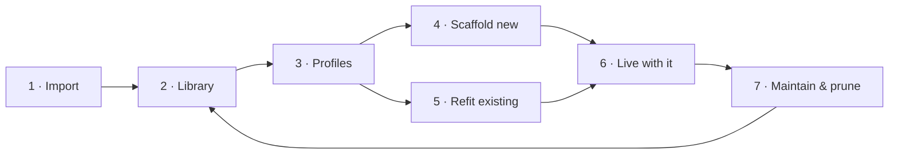

# Harneo — Product Context

> The single source of truth for **what** Harneo is and **how a user moves through it**. Read this before designing or building anything. Decisions here were made on 2026-10-17; change them here first, then in code.

## 1. What Harneo is

**Harneo is a harness manager for Claude Code.** It is a free, open-source desktop app (MIT, built with Tauri) for building and maintaining a personal **software factory**: the set of skills, commands, subagents, settings, MCP servers and other artifacts that shape how an AI coding agent works in a project.

- **Positioning:** *Your software factory, fitted to every project in one click.* Harneo keeps every AI Artifact you trust in one library, lets you compose profiles from it, and installs the right profile into any project, safely, with a backup, and with proof of what's inside.
- **Not a skill manager.** It manages the whole harness, not only skills.
- **Not for sale.** It's a personal tool, shared openly.
- **Claude Code only in v1**, but the artifact model must let other agents (Codex, Cursor, Gemini CLI…) be added later as adapters, without a rewrite.

### Who it's for

A builder who works across many projects with Claude Code: a solo dev, a consultant, or a tech lead. They've collected skills, hooks and agents from public packs (Matt Pocock's skills, pstack, Addy Osmani's agent-skills) and from their own work.

**Design target (decided 2026-10-19):** others first. Harneo is designed for developers who discover it on GitHub and have never heard of a bundle, a profile or a refit; the maintainer's own workflow comes second.

**Their pain:**
- Every new repo means copying `.claude/` by hand.
- They forget where each artifact came from and don't know what's outdated, unused or unsafe.
- They're afraid of overwriting a project's own setup.

### Glossary

| Term | Meaning |
| :--- | :--- |
| **AI Artifact** | One unit that customizes Claude Code (a skill, a settings template, a plugin…). See §2. |
| **Library** | Harneo's own store of imported artifacts, kept outside every project and outside `~/.claude`. |
| **Bundle** | A group of artifacts that only work together (e.g. a command + the skill it calls + the subagents that skill uses). |
| **Profile** | A named selection of library artifacts and bundles that gets installed into projects. Unlimited. |
| **Scaffold** | Installing a profile into a new, empty project. |
| **Refit** | Installing or switching a profile in a project that already has a harness. |
| **Project registry** | Harneo's list of the projects it has scaffolded or refitted, with the profile and version each one runs. |

## 2. The AI Artifacts

Harneo's library holds **10 artifact types**. They were chosen from the 21 file types in the Claude Code docs (code.claude.com, checked 2026-10-17). Each type is something a user picks as **one unit** when composing a profile.

| # | Artifact | Installs to (project) | Format | Travels with it / depends on | One item = |
| :-- | :--- | :--- | :--- | :--- | :--- |
| 1 | **CLAUDE.md** | `./CLAUDE.md` | Markdown, `@path` imports | The files it `@imports` | One file |
| 2 | **Rules** | `.claude/rules/*.md` | Markdown, optional path-gating | — | One rule file |
| 3 | **Skills** | `.claude/skills/<name>/` | `SKILL.md` (YAML: `name`, `description`, `disable-model-invocation`, `allowed-tools`, `hooks`…) + supporting files | Its folder's scripts and files; other skills or agents named in its text (→ bundles) | One skill folder |
| 4 | **Commands** | `.claude/commands/*.md` | Markdown + YAML | The skill or agent it calls (→ bundles). The docs now prefer skills; a skill wins on a name clash | One command file |
| 5 | **Subagents** | `.claude/agents/*.md` | Markdown + YAML (`name`, `description`, `tools`, `model`, `skills`, `mcpServers`…) | Skills and MCP servers named in its fields (→ bundles) | One agent file |
| 6 | **Settings** | `.claude/settings.json` | JSON: **hooks, permissions (allow/ask/deny), env, model, status line, output style, enabled plugins… all in one** | The scripts its hooks and status line point to (e.g. `.claude/hooks/*.sh`) | **One whole `settings.json` template** |
| 7 | **MCP servers** | `.mcp.json` | JSON (`stdio` / `http` / `ws`); secrets only as `${VAR}` | Sometimes a `headersHelper` script | One server. Harneo writes `.mcp.json` from the profile's selected servers |
| 8 | **Output styles** | `.claude/output-styles/*.md` | Markdown + YAML | Selected by the `outputStyle` key in Settings | One style file |
| 9 | **Workflows** | `.claude/workflows/*.js` | JavaScript (`export const meta`) | The subagents it orchestrates (→ bundles) | One workflow file |
| 10 | **Plugins** | Enabled through Settings (`enabledPlugins`) from their marketplace | `.claude-plugin/plugin.json` + folders | **Everything inside it:** skills, agents, commands, hooks, MCP, mods, monitors, LSP servers, `bin/` tools. Its marketplace is its source | One plugin, kept whole, never unpacked |

**Settings is one artifact on purpose.** Hooks, permissions, the status line and every other key are **not** managed separately. A user adds a **template `settings.json`** to the library (e.g. "strict deny rules + path-guard hook + my status line") and picks one per profile. Its hook and status-line scripts travel with it as part of the same item.

### Deliberately not in the library

| Left out | Why |
| :--- | :--- |
| Keybindings, themes | Personal user-level preferences, not part of a project's factory |
| Auto memory (`~/.claude/projects/
/memory/`) | Written by Claude at runtime, not authored |
| Mods, monitors, LSP servers, `bin/` tools as separate items | They only exist inside plugins, so they come with their plugin |
| Marketplaces as separate items | A marketplace is a plugin's source, recorded on the plugin |
| `CLAUDE.local.md`, `settings.local.json` | Each developer's own gitignored overrides; Harneo never touches them |
| `~/.claude` (user scope) as a profile target | Profiles target projects only. `~/.claude` is just a folder you can import from |

## 3. The user journey

### Stage 1 — Import: "bring everything I already trust"

1. **Import a local folder.** Point Harneo at a repo or at `~/.claude/`. It lists every artifact found, grouped by the 10 types, and the user ticks what to import.
2. **Import from a git URL.** Paste e.g. `github.com/mattpocock/skills` and tick the artifacts you want. For each one Harneo stores the **URL, branch, subfolder and commit**.
3. **AI dependency detection.** Claude reads each imported artifact and proposes **bundles**, e.g. "`grill-me` calls `grilling`" or "`/ship` uses 3 subagents". The user confirms or edits. It runs through the user's installed `claude` CLI, so there's no API key. Sending artifact text to Claude this way is the default.
4. **Security audit on arrival.** Each artifact gets a **trust score** and its findings (prompt injection, credential theft, plaintext secrets, dangerous commands, supply-chain risk…). It also gets **permission transparency**: which files, network domains, shell commands and environment variables it can reach.

### Stage 2 — Library: "one place, everything known"

1. **The library is Harneo's own store**, in the app's data folder, outside every project and outside `~/.claude`. It contains **only what the user imported**. Anything in a project or in `~/.claude` that was never imported does not appear. There are no "project" or "global" scopes.
2. **Browse by type, bundle or source.** Each row shows:
   - invocation mode (auto / manual);
   - source and version, plus an *outdated* flag;
   - trust score;
   - **usage**: sessions, last used, and an activity graph, read from Claude's session logs (`~/.claude/projects/`) so past sessions count without setup.
3. **Promote to library:** found a good artifact inside a registered project? One click imports it, the same as importing any folder.

### Stage 3 — Profiles: "my factory, in several sizes"

1. **Create a profile** by picking artifacts and bundles. Picking an artifact pulls in its whole bundle, so nothing ships half-wired.
2. **Clone a profile** to make a bigger or smaller one, e.g. clone *Light*, add review and doubt skills, call it *Heavy*. Cloning replaces nested or inheriting profiles.
3. **Pick one Settings template** (its hooks, permissions and status line come with it), then **add MCP servers** such as GitHub or Sentry. Secrets are stored only as `${VAR}` placeholders, never as values.
4. **Invocation mode per skill:** mark heavy skills *manual-only* (`disable-model-invocation: true`) so they never fire by accident.
5. **Export / import a profile** as one file, to share it or move machines.
6. **Run a harness check** on the profile, one button that tests whether the profile is good before it goes into any project. *Noted, not yet scoped*; see §6.

### Stage 4 — Scaffold a new project: "a full harness in one click"

1. Pick an empty folder and a profile.
2. **Dry-run preview:** every file that will be written, with its full content, before anything touches disk.
3. Write. Harneo also writes a short **`HARNESS.md`** describing what's installed, from which profile and version, and what each part is for.
4. The project joins the **project registry**.

### Stage 5 — Refit an existing project: "upgrade without fear"

1. Open a folder that already has a harness. Harneo shows **what exists vs what the profile brings**, item by item.
2. For each item, choose **keep / replace / delete**. **Replacing always wins over merging**: Harneo never merges file contents. **Every replaced file is backed up first.**
3. Same dry-run preview (now as a content diff) and `HARNESS.md` as Stage 4.

> [!WARNING]
> **The risk the replace-don't-merge rule creates.** Replacing `CLAUDE.md` or `settings.json` in an existing project wipes that project's own content: its build commands, its deny rules. The backup makes it recoverable, but the preview must **flag these two files in red** whenever the project's version contains lines the profile doesn't have.

### Stage 6 — Live with it: "it stays right"

1. **Live rescan:** Harneo watches the library and registered projects and refreshes when files change on disk.
2. **Drift check:** e.g. "3 files in *my-api* no longer match profile *Heavy v4*." The user chooses: re-apply the profile, or promote the change into the library.
3. **Outdated flag + update:** when upstream changes, the library marks the artifact *outdated*; one click updates the library copy.
4. **Protect local edits:** if the user edited that artifact, the update shows upstream vs theirs and they choose. Harneo never overwrites silently.
5. **Switch / upgrade profile:** move *my-api* from *Light* to *Heavy*. Harneo applies only the difference.
6. **Clean removal:** removing a profile from a project restores the backed-up originals.

### Stage 7 — Maintain and prune: "a lean harness"

1. **Cleanup suggestions** from usage data, e.g. "`webperf` unused for 9 weeks in every project" or "`tdd` duplicated in 3 profiles".
2. Remove the artifact from the profile, then push the change to registered projects with Stage 6's switch.

### Everywhere — the CLI companion

`harneo scaffold --profile heavy ./my-api`, `harneo status`, `harneo update`: the same engine as the app, for terminals and scripts.

## 4. Feature decisions (v1)

| Feature | v1? | Note |
| :--- | :---: | :--- |
| Import local folder / git URL | ✅ | Git imports store URL, branch, subfolder and commit |
| Unlimited profiles · bundles · AI dependency detection | ✅ | No existing tool does bundles |
| Nested profiles | ❌ → **Clone** | Clone a profile and add to it |
| Scaffold new · refit existing · add MCP servers | ✅ | |
| Per-type merge rules | ❌ → **Replace** | Replacing always wins, always with a backup |
| Dry-run preview · backup + clean removal · switch profile · `HARNESS.md` | ✅ | |
| Security audit · permission transparency | ✅ | Inspired by HarnessKit's audit rules |
| Outdated flag · protect local edits · usage tracking · cleanup suggestions | ✅ | |
| Drift check · project registry · live rescan | ✅ | |
| Invocation mode toggle · promote to library | ✅ | |
| Global vs project scope | ❌ → **one app library** | The library shows only what was imported |
| Export / import profile · CLI companion | ✅ | |
| Multi-agent ready | ✅ design only | Claude only in v1; any agent addable later as an adapter |
| Harness check on a profile | 🟡 noted | Not yet scoped (§6) |
| Shopping-cart profile builder | 🟡 UX note | For the UI phase (§6) |
| In-app editor · AI-assisted authoring | ❌ | Edit artifacts in your own editor |
| Enable / disable switch | ❌ | |
| Marketplace browsing | ❌ | Import by URL instead |
| Plugins | ✅ kept whole | Enabled from their marketplace, never unpacked |
| Distribution | Source only | Users clone and build for their own OS. The maintainer builds and uses Linux only. No installers, no code signing |
| Build-from-source guide | ✅ | `BUILDING.md`: prerequisites per OS (Rust, Node, Tauri system packages: WebKitGTK on Linux, WebView2 on Windows, Xcode tools on macOS), then the build and run commands |

## 5. Constraints for the build

- **Cross-platform code, Linux-tested.** Tauri builds on macOS, Windows and Linux. Use Tauri's path APIs, never hard-coded Linux paths like `~/.local/share`, and keep OS-specific shell calls out of the core. macOS and Windows stay "untested by the maintainer" until someone else confirms they build.
- **Three web engines.** Tauri renders with each OS's own engine: WebKit on macOS, WebView2 on Windows, WebKitGTK on Linux. Keep the UI within what all three support; WebKitGTK is the weakest.
- **Whole-file writes.** `settings.json` comes from one Settings template. `.mcp.json` is built from the profile's selected servers and then written whole. Nothing is ever merged into an existing file.
- **Backups before every write**, and restore on removal.
- **No secrets stored.** MCP secrets exist only as `${VAR}` placeholders.
- **Never touch** `CLAUDE.local.md`, `settings.local.json`, or anything outside the target project and Harneo's own data folder, except reading Claude's session logs for usage.
- **Design** with the Impeccable frontend skill from the start.

## 6. Noted for later (don't forget)

**Harness check.** It's close to the "is this good?" validation that was ruled out as too non-deterministic, so split it in two when it gets designed:
- **Rule-based checks** are cheap and certain: a bundle with a missing dependency, two skills (or a skill and a command) with the same name, Settings naming an output style or plugin the profile doesn't include, a hook pointing to a missing script, the worst trust score in the profile.
- **Judgement checks** ("is this profile good?", overlapping skills, gaps) need an AI review and can only advise.

**Shopping-cart UX.** The library is the shop and the profile is the cart. As the user puts artifacts and bundles into the cart, the profile's **folder tree fills up live** next to it (`.claude/skills/…`, `.claude/agents/…`, `settings.json`, `.mcp.json`), showing exactly the project it will produce.

**Duplicated scripts across Settings templates.** A hook used in three templates lives in three copies, and changing one lets the others drift unnoticed. That's acceptable for v1, and it'll be the first pain point once a user has several profiles.

**MCP servers as templates?** They're one item per server today. Switching to whole-`.mcp.json` templates, like Settings, is a small change if per-server proves awkward.

## 7. What exists today, and what to borrow

| | Harneo (v1 target) | HarnessKit | Loadout | tackroom | Moltenbase |
| :--- | :---: | :---: | :---: | :---: | :---: |
| Library of artifacts not installed anywhere | ✅ | ❌ | ❌ | ✅ (`~/.agents`) | ❌ |
| Profiles for projects | ✅ all types | 🟠 no hooks, agents, commands | ❌ | ❌ user-level only | ❌ |
| Bundles (dependencies) | ✅ | ❌ | ❌ | ❌ | ❌ |
| Safe refit (preview + backup + restore) | ✅ | 🟠 conflict list; deletes on removal | — | ? | — |
| Updates that respect local edits | ✅ | ❌ overwrites | — | 🟠 lock-pinned | — |
| Usage tracking + cleanup | ✅ | ❌ | ✅ usage only | 🟠 via AgentsView | ✅ usage only |
| Security audit | ✅ | ✅ | ❌ | 🟠 `doctor` | ❌ |
| Desktop on macOS / Windows / Linux | ✅ from source; official build Linux | ❌ macOS only | ❌ macOS only | CLI + web | ? |

*Competitor cells come from READMEs and HarnessKit's source code (2026-10-17); "?" means not checked.*

- **[HarnessKit](https://github.com/RealZST/HarnessKit)** (Tauri 2 + Rust + React, Apache-2.0) is the closest tool and the main reference. Harneo is built from scratch, not forked, because its core is library-first and HarnessKit deliberately has no library ("no shadow copies").
  - **Worth studying or borrowing, with attribution as Apache-2.0 requires:** the Claude path and format knowledge in its agent adapter, its MCP and hook JSON handling, atomic file writes, its static audit rules (`auditor/rules.rs`) and trust-score tiers, and its Kit zip format.
  - **Flaws to avoid:**
    - Kit removal deletes overwritten files.
    - Updates silently overwrite local edits.
    - The update check compares only the main branch of the whole repo, ignoring branch and subfolder.
    - Kits can't carry hooks, subagents or commands.
- **[Loadout](https://github.com/migsilva89/loadout)** (macOS, Swift): good reference for usage counts read from session logs, with "unsupported" shown rather than a misleading zero.
- **[tackroom](https://github.com/yourconscience/tackroom)** (Go): good reference for pinning external skills in a lock file.
- **Moltenbase** (Rob Shocks): the original inspiration, a skill inventory showing scope, invocation mode, sessions, last used, an activity graph, provenance and install integrity. Harneo goes one mile further: library, profiles, bundles and safe scaffolding.

**The "one mile further":** Harneo is the only tool that holds a library, ships it into projects as complete bundles, and never loses a file doing it.
