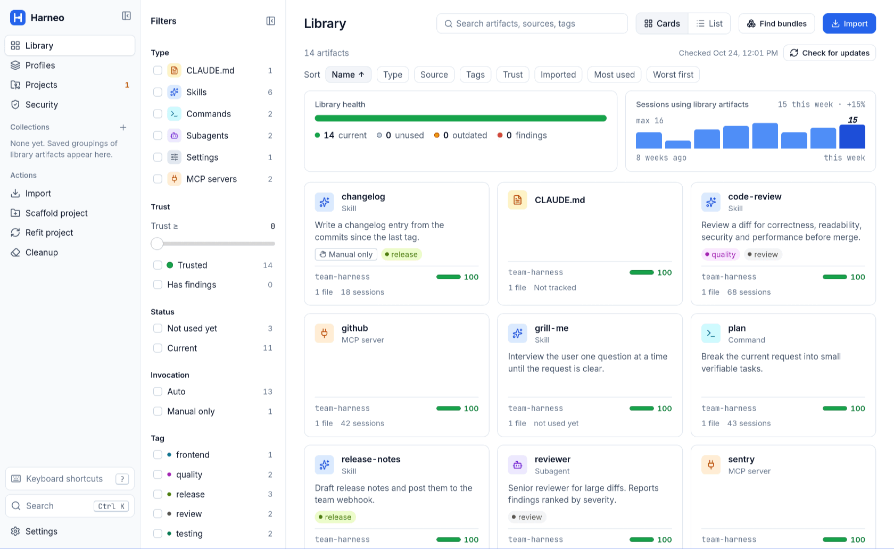
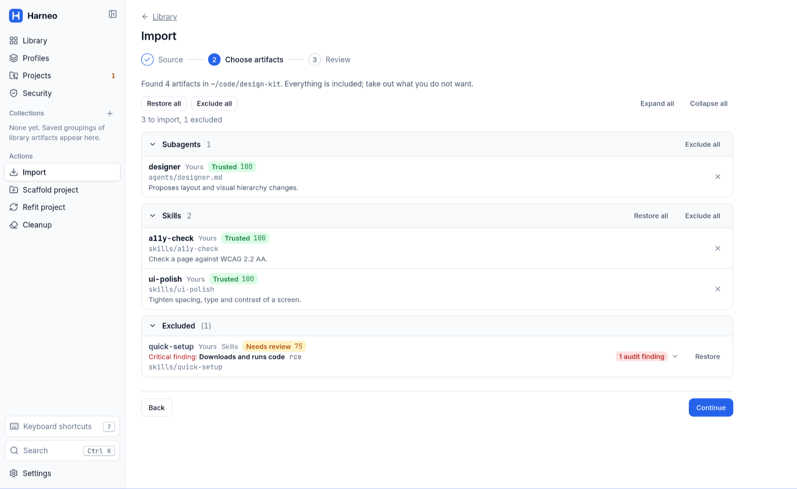
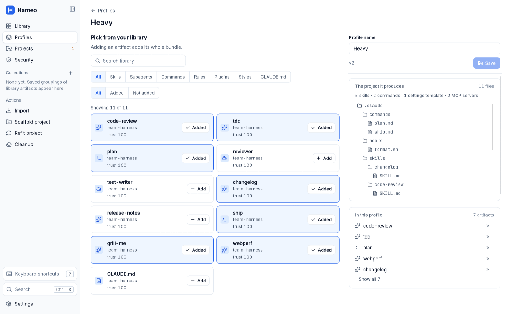
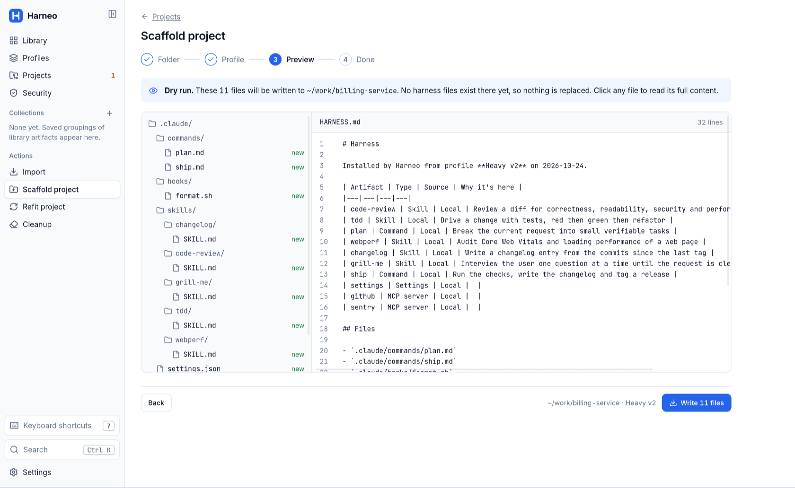
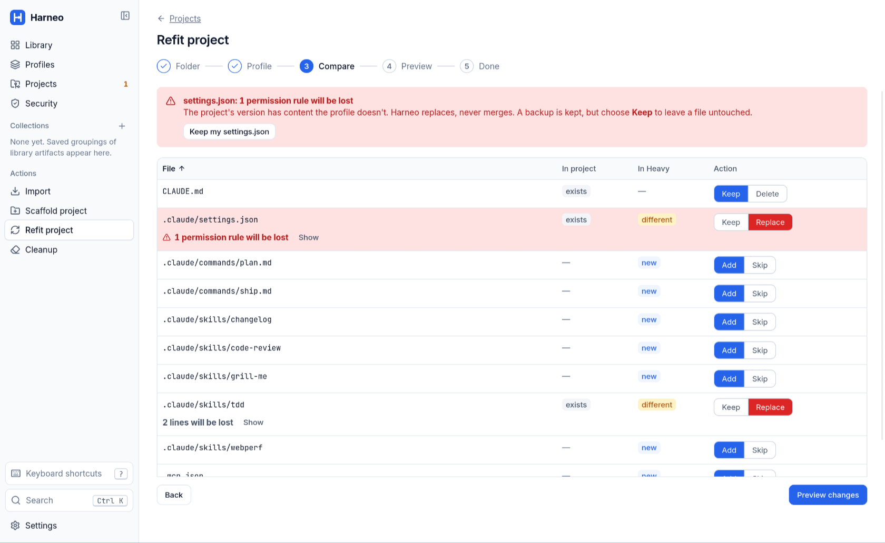
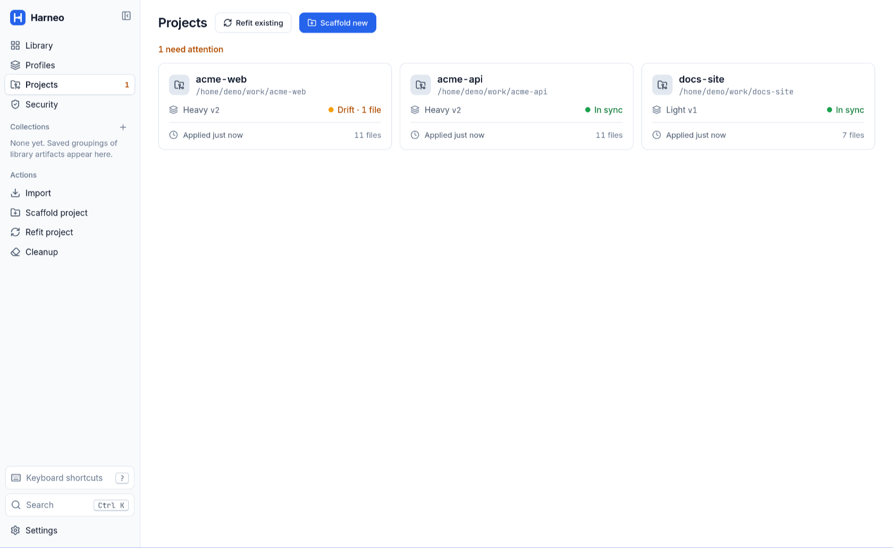
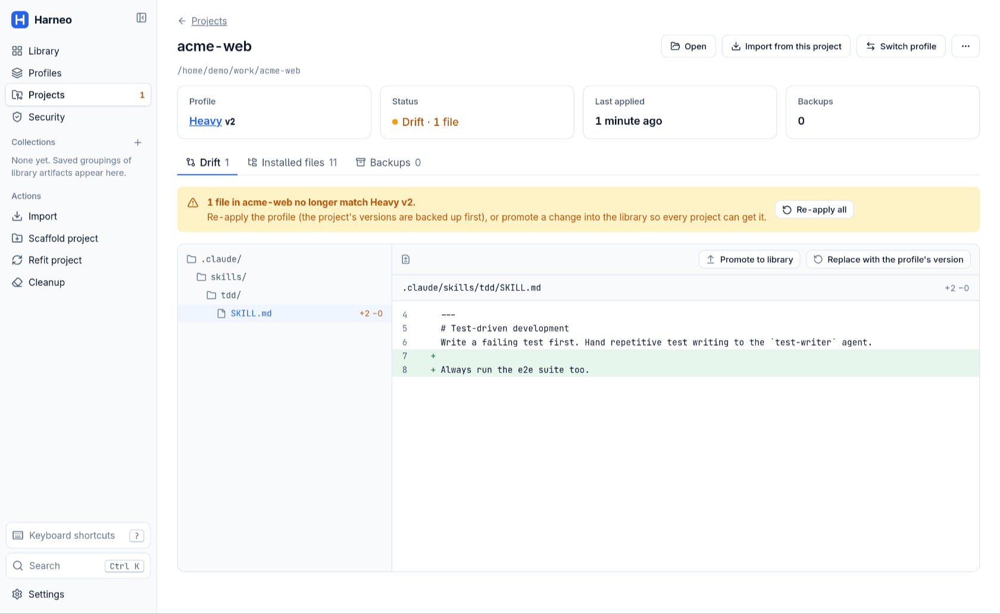

# Harneo

Harneo is a harness manager for Claude Code: a free, open-source desktop app, built with Tauri, that keeps a library of AI Artifacts (skills, commands, subagents, settings, MCP servers and more), composes profiles from it, and scaffolds or refits projects from a profile. It is a personal tool, shared openly. Distribution is source only: you build it for your own OS.

## Install

Harneo is built and tested on Linux. Windows and macOS should work but are untested; [BUILDING.md](BUILDING.md) has the per-OS details.

```bash
git clone https://github.com/ibrahimkobeissy/harneo.git
cd harneo
./scripts/setup.sh                    # installs what is missing (Rust, Node 22+, system libraries) after a confirmation
npm ci
npm run tauri build -- --no-bundle    # release build of the app
cargo build --release -p harneo-cli   # release build of the CLI
```

On Windows run `scripts\setup.ps1` instead of `setup.sh`.

The build writes two binaries: the app at `target/release/harneo-app` and the CLI at `target/release/harneo` (`.exe` on Windows). No installer is made. Copy them somewhere on your `PATH`, for example:

```bash
install -m 755 target/release/harneo-app target/release/harneo ~/.local/bin/
```

To update, `git pull` and run the two build commands again. To just try the app without installing, run `npm run tauri dev`.

## Use



1. **Import.** Point Harneo at a folder (a repo, or `~/.claude/`) or paste a git URL, then tick the artifacts to keep. Each one gets a security audit and a trust score on arrival, and risky ones start excluded.

   

2. **Library.** Browse what you imported by type, bundle or source, with tags, collections, usage and an *outdated* flag. Only what you imported is there.
3. **Profiles.** Pick artifacts (and their bundles), one Settings template and MCP servers to make a profile. Clone it to make a lighter or heavier one; export it as one file to share.

   

4. **Scaffold or refit.** Scaffold writes a profile into an empty folder. Refit an existing project chooses keep, replace or delete per item, and warns in red when a replaced file loses the project's own content. Both show a dry-run preview first, back up every replaced file and write a `HARNESS.md`.

   

   

5. **Live with it.** **Projects** shows drift from the profile (re-apply, or promote the change to the library). **Cleanup** suggests unused or duplicated artifacts. Removing a profile from a project restores its originals.

   

   

The screenshots use dummy data.

Optional: in **Settings → Claude**, *Detect bundles and tags at import* asks your own `claude` CLI to propose bundles and tags. It is off by default, because it sends artifact text to Claude on your plan.

The CLI uses the same library as the app:

```bash
harneo scan ./some-folder                       # list the artifacts and problems in a folder
harneo profiles                                 # list your profiles
harneo scaffold --profile heavy ./my-api        # write a profile into a new project (--dry-run to preview)
harneo status                                   # drift of every registered project
harneo update                                   # update outdated artifacts that have no local edits
harneo --help                                   # everything else
```

## Develop

| Goal                         | Command                                 |
| ---------------------------- | --------------------------------------- |
| Run the app (dev)            | `npm run tauri dev`                     |
| Build the app (release)      | `npm run tauri build -- --no-bundle`    |
| Run the CLI                  | `cargo run -p harneo-cli -- --version`  |
| Test                         | `npm test` and `cargo test --workspace` |
| Lint                         | `npm run lint`                          |
| Fix lint and format          | `npm run fix`                           |
| Gate after each edit         | `npm run check:fast`                    |
| Gate before a ticket is done | `npm run check:task`                    |
| Gate before merge to `main`  | `npm run check:full`                    |

`CONSTRAINTS.md` defines what each check runs. `./scripts/setup.sh --dev` installs the gate tools.

## License

MIT, see [LICENSE](LICENSE).
