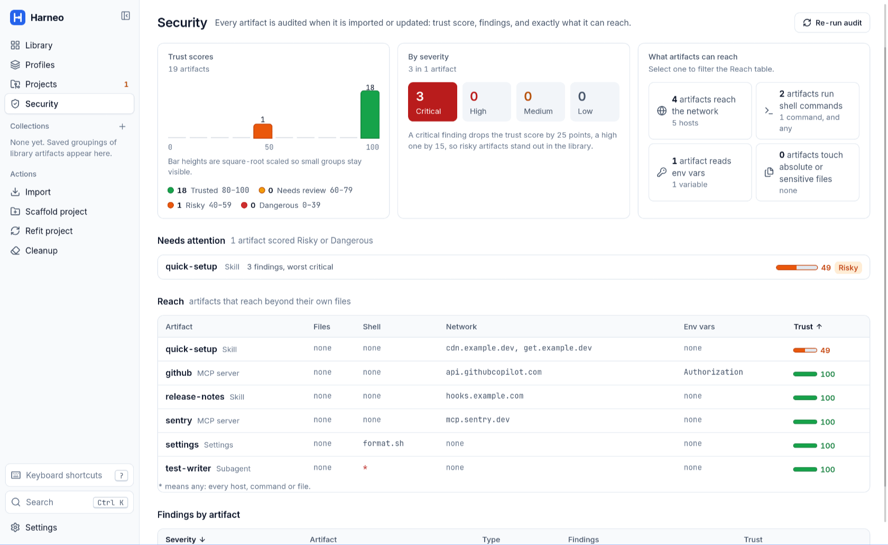
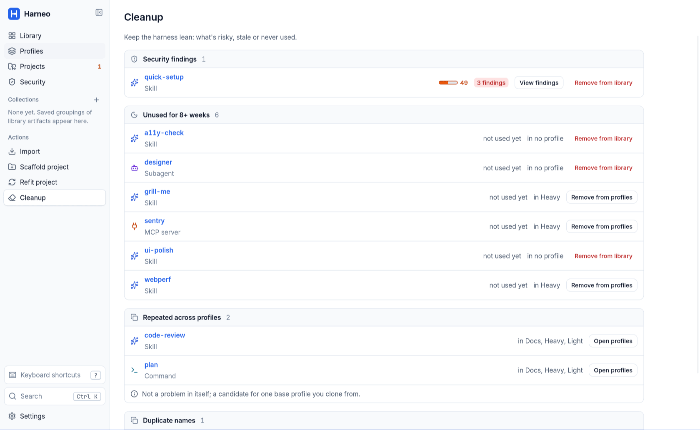

<p align="center">
  
</p>

<h1 align="center">Harneo</h1>

<p align="center">
  <strong>A harness manager for Claude Code.</strong><br>
  Keep every skill, command, subagent, setting and MCP server you trust in one library,<br>
  compose profiles from it, and install the right profile into any project: previewed, backed up, reversible.
</p>

<p align="center">
  <a href="LICENSE"></a>
  
  
  
  
</p>

<p align="center">
  <a href="#install">Install</a> ·
  <a href="#how-it-works">How it works</a> ·
  <a href="#cli">CLI</a> ·
  <a href="#contributing">Contributing</a>
</p>


## Why

If you use Claude Code across many projects, your harness (`.claude/` skills, commands, subagents, hooks, `settings.json`, MCP servers, `CLAUDE.md`) ends up copied by hand from repo to repo. Copies drift, nobody remembers where a skill came from, risky ones slip in, and refitting an existing project means overwriting files you meant to keep.

Harneo keeps the library **outside** your projects and ships it **into** them:

- **One library** for the whole harness, not only skills: skills, commands, subagents, settings, MCP servers, output styles, workflows, plugins, `CLAUDE.md` and rules.
- **A security audit on import.** Every artifact gets a trust score, findings by severity and what it can reach (network, shell, environment variables, files). Risky ones start excluded.
- **Profiles.** Compose a light or heavy setup once, clone it, export it as one file.
- **Safe writes.** Every write is previewed first, every replaced file is backed up, and removing a profile restores the originals. Losing a project's own `CLAUDE.md` or `settings.json` lines is flagged in red.
- **Drift and cleanup.** See which projects diverged from their profile, which artifacts are outdated, unused or duplicated.
- **Local first.** No account, no server, no analytics. A desktop app and a CLI share the same library. See [Privacy](#privacy) for what the optional Claude features send.

## Status

Harneo is **v0.1, early and moving fast**. It is a personal tool shared openly, under the MIT license.

| Platform | State |
| -------- | ----- |
| Linux    | Built and tested by the maintainer (Arch; Debian/Ubuntu and Fedora packages documented). |
| macOS    | Should work, **untested by the maintainer**. Reports welcome. |
| Windows  | Should work, **untested by the maintainer**. Reports welcome. |

There are no prebuilt binaries or installers: **you build Harneo from source for your own OS**. It takes one setup script and two build commands, below.

## Install

Every OS follows the same five steps: install the prerequisites, clone, run the setup script, build, put the two binaries on your `PATH`. The setup script shows every command it will run and asks before running any of them; `--check` (`-Check` on Windows) only reports what is missing.

What you end up with:

| Binary | What it is |
| ------ | ---------- |
| `harneo-app` | The desktop app. |
| `harneo` | The CLI. Same engine, same library. |

Both are written to `target/release/` (with `.exe` on Windows). No installer is built.

### Linux

**1. Prerequisites.** `git`, and a distro that `setup.sh` knows: Arch (pacman), Debian or Ubuntu (apt), Fedora (dnf). Other distros work if you install the [Tauri 2 Linux packages](https://v2.tauri.app/start/prerequisites/#linux) yourself; [BUILDING.md](BUILDING.md#linux-tested) lists them per distro.

**2–4. Clone, set up, build.**

```bash
git clone https://github.com/ibrahimkobeissy/harneo.git
cd harneo
./scripts/setup.sh                    # installs Rust, Node 22+ and WebKitGTK 4.1 and friends, after a confirmation
npm ci
npm run tauri build -- --no-bundle    # the app
cargo build --release -p harneo-cli   # the CLI
```

If `setup.sh` just installed Rust through rustup, open a new shell (or run `. "$HOME/.cargo/env"`) before building.

**5. Install on your `PATH`.**

```bash
install -m 755 target/release/harneo-app target/release/harneo ~/.local/bin/
harneo --version
harneo-app &
```

Optional, to get Harneo in your app launcher, create `~/.local/share/applications/harneo.desktop`:

```ini
[Desktop Entry]
Type=Application
Name=Harneo
Comment=Harness manager for Claude Code
Exec=harneo-app
Icon=/path/to/harneo/src-tauri/icons/icon.png
Categories=Development;
```

### macOS

**1. Prerequisites.**

```bash
xcode-select --install                # compilers and git
```

Then install [Homebrew](https://brew.sh); `setup.sh` uses it for the rest.

**2–4. Clone, set up, build.**

```bash
git clone https://github.com/ibrahimkobeissy/harneo.git
cd harneo
./scripts/setup.sh                    # installs rustup and node@22 through Homebrew, after a confirmation
```

Homebrew installs `node@22` and `rustup` *keg-only*: they are not on your `PATH` until you add them. If `node --version` or `rustup --version` fails after setup, add them and open a new shell:

```bash
echo 'export PATH="$(brew --prefix node@22)/bin:$(brew --prefix rustup)/bin:$HOME/.cargo/bin:$PATH"' >> ~/.zshrc
exec zsh
rustup default stable
```

Then build:

```bash
npm ci
npm run tauri build -- --no-bundle    # the app
cargo build --release -p harneo-cli   # the CLI
```

**5. Install on your `PATH`.**

```bash
mkdir -p ~/.local/bin
install -m 755 target/release/harneo-app target/release/harneo ~/.local/bin/
echo 'export PATH="$HOME/.local/bin:$PATH"' >> ~/.zshrc   # if ~/.local/bin is not on your PATH yet
harneo --version
harneo-app &
```

`--no-bundle` builds a plain binary, not a `.app`, so Harneo starts from the terminal and does not appear in Launchpad. If you want a `.app`, see [Bundles](BUILDING.md#bundles-optional) in BUILDING.md.

### Windows

**1. Prerequisites.** Windows 10 or 11 with [winget](https://aka.ms/getwinget) (it ships with current versions) and [Git for Windows](https://git-scm.com/download/win) (`winget install --id Git.Git -e`). `setup.ps1` installs the rest: rustup, Node.js LTS, Visual Studio 2022 Build Tools with the C++ workload, and the WebView2 runtime.

**2–4. Clone, set up, build.** In PowerShell:

```powershell
git clone https://github.com/ibrahimkobeissy/harneo.git
cd harneo
powershell -ExecutionPolicy Bypass -File scripts\setup.ps1   # installs what is missing, after a confirmation
```

Close and reopen PowerShell so the new tools are on your `PATH`, then:

```powershell
cd harneo
npm ci
npm run tauri build -- --no-bundle    # the app
cargo build --release -p harneo-cli   # the CLI
```

**5. Install on your `PATH`.**

```powershell
$bin = "$env:LOCALAPPDATA\Programs\Harneo"
New-Item -ItemType Directory -Force $bin | Out-Null
Copy-Item target\release\harneo-app.exe, target\release\harneo.exe $bin
[Environment]::SetEnvironmentVariable('Path', "$([Environment]::GetEnvironmentVariable('Path','User'));$bin", 'User')
```

Open a new terminal, then `harneo --version` and `harneo-app`. To pin it to Start, right-click `harneo-app.exe` in that folder → *Pin to Start*.

### Try it without installing

From the repo, after the setup script and `npm ci`:

```bash
npm run tauri dev                     # the app, with hot reload
cargo run -p harneo-cli -- --help     # the CLI
```

### Update

```bash
git pull
npm ci
npm run tauri build -- --no-bundle
cargo build --release -p harneo-cli
```

Then copy the two binaries over the old ones, as in step 5. Your library is kept: it lives in your data folder, not next to the binaries.

### Uninstall

Delete the two binaries, then, if you want to remove your library as well, the data folder (`harneo paths` prints it):

| OS | Data folder |
| -- | ----------- |
| Linux | `~/.local/share/io.harneo` |
| macOS | `~/Library/Application Support/io.harneo` |
| Windows | `%APPDATA%\io.harneo` |

Harneo writes nothing else outside the projects you point it at. Projects keep the files a profile wrote into them; remove a profile from a project in the app first to restore its originals.

### Troubleshooting

- **Something is missing.** `./scripts/setup.sh --check` (or `scripts\setup.ps1 -Check`) lists it and installs nothing.
- **Linux: blank window or a WebKit error.** Make sure WebKitGTK **4.1** is installed (not 4.0); on NVIDIA, try `WEBKIT_DISABLE_DMABUF_RENDERER=1 harneo-app`.
- **macOS or Windows problem.** These platforms are untested by the maintainer. Please [open an issue](https://github.com/ibrahimkobeissy/harneo/issues/new/choose) with your OS version and the full error.

[BUILDING.md](BUILDING.md) has every prerequisite in detail, the options of the setup scripts and the contributor tools.

## How it works

1. **Import.** Point Harneo at a folder (a repo, or `~/.claude/`) or paste a git URL, then tick the artifacts to keep. Each one gets a security audit and a trust score on arrival, and risky ones start excluded.

   

2. **Library.** Browse what you imported by type, bundle or source, with tags, collections, usage and an *outdated* flag. **Security** sums up the audit: trust scores, findings by severity, and what each artifact can reach.

   

3. **Profiles.** Pick artifacts (and their bundles), one Settings template and MCP servers to make a profile. Clone it to make a lighter or heavier one; export it as one file to share.

   

4. **Scaffold or refit.** Scaffold writes a profile into an empty folder. Refit an existing project chooses keep, replace or delete per item, and warns in red when a replaced file loses the project's own content. Both show a dry-run preview first, back up every replaced file and write a `HARNESS.md`.

   

   

5. **Live with it.** **Projects** shows drift from the profile (re-apply, or promote the change to the library). **Cleanup** suggests unused or duplicated artifacts. Removing a profile from a project restores its originals.

   

   

   

The screenshots use dummy data.

## CLI

The CLI uses the same library as the app, for terminals and scripts:

```bash
harneo scan ./some-folder                       # list the artifacts and problems in a folder
harneo audit ./some-folder                      # trust score, findings and reach of each artifact
harneo profiles                                 # list your profiles
harneo scaffold --profile heavy ./my-api        # write a profile into a new project (--dry-run to preview)
harneo status                                   # drift of every registered project
harneo update                                   # update outdated artifacts that have no local edits
harneo paths                                    # where your library lives
harneo --help                                   # everything else
```

## Privacy

Harneo has no server and no account. The only things that ever leave your machine go through your own `claude` CLI, on your own Claude plan, and each one has a switch in **Settings**:

| Feature | Default | What is sent |
| ------- | ------- | ------------ |
| Confirm audit findings with Claude | **On** | For each audit finding: its rule, file, line and 3 lines of context each side (secret values replaced), plus the artifact's name and description, so Claude can tell an attack from text that defends against one. Nothing else from the artifact. `harneo audit --no-claude` skips it for one run. |
| Ask Claude about repo layouts at import | **On** | Only when an import leaves files Harneo couldn't place: file paths, manifests and the first 40 lines of the unplaced Markdown files. Secret-looking files are listed by name, never read. |
| Detect bundles and tags at import | Off | Artifact text, to propose bundles and tags. |

If the `claude` CLI is not installed, none of these run. Each Settings row says exactly what it sends and to whom.

- **Error reports (off unless you set it up).** Harneo can report errors to a Sentry project *of your own*. Nothing is sent unless you set `HARNEO_SENTRY_DSN`; no DSN is built in. [BUILDING.md](BUILDING.md#error-reporting-optional) explains what is and isn't sent.
- **Secrets.** MCP secrets are stored only as `${VAR}` placeholders, never as values.

## Develop

| Goal                         | Command                                 |
| ---------------------------- | --------------------------------------- |
| Run the app (dev)            | `npm run tauri dev`                     |
| Build the app (release)      | `npm run tauri build -- --no-bundle`    |
| Run the CLI                  | `cargo run -p harneo-cli -- --version`  |
| Test                         | `npm test` and `cargo test --workspace` |
| Lint                         | `npm run lint`                          |
| Fix lint and format          | `npm run fix`                           |
| Gate after each edit         | `npm run check:fast`                    |
| Gate before a change is done | `npm run check:task`                    |
| Gate before merge to `main`  | `npm run check:full`                    |

`./scripts/setup.sh --dev` installs the gate tools; [CONSTRAINTS.md](CONSTRAINTS.md) defines what each check runs. The code is a Tauri 2 app (`src-tauri/`, React + TypeScript in `src/`) on a shared Rust core (`crates/harneo-core`) used by the app and the CLI (`crates/harneo-cli`). [CONTEXT.md](CONTEXT.md) is the product source of truth.

## Contributing

Bug reports, platform reports (especially macOS and Windows) and pull requests are welcome. Start with [CONTRIBUTING.md](CONTRIBUTING.md). Security issues: see [SECURITY.md](SECURITY.md), please don't open a public issue. Everyone taking part follows the [Code of Conduct](CODE_OF_CONDUCT.md).

## Acknowledgements

Harneo's security audit rules are ported from [HarnessKit](https://github.com/RealZST/HarnessKit) (Apache 2.0). See [THIRD_PARTY_NOTICES.md](THIRD_PARTY_NOTICES.md).

## License

[MIT](LICENSE) © 2026 Ibrahim Kobeissy
